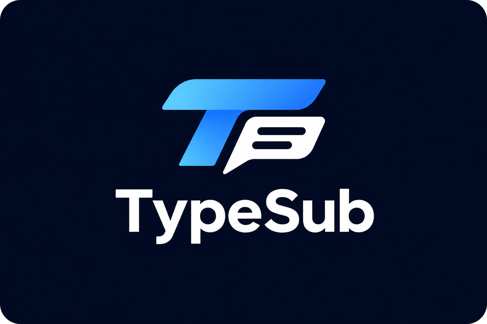

# TypeSub

English | [Chinese](README.zh-CN.md)

<p align="center">
  
</p>

> TypeSub is in early development. The downloads below are pre-release builds.

[](https://github.com/Top-Dimension/TypeSub/releases/download/0.1.2/typesub_0.1.2_amd64.deb)
[](https://github.com/Top-Dimension/TypeSub/releases/download/0.1.2/TypeSub-Setup-0.1.2-x64.exe)


[](LICENSE)

TypeSub recognizes speech from your microphone and displays live captions one character at a time in an OBS Browser Source.

**The Windows desktop app has moved to WinUI 3. Linux continues to use Electron.** The Windows installer bundles a Node.js service for live captions. Both platforms use the Rust engine for caption timing.

The interface is available in English and Chinese. Use the language selector in the top bar or on the first-run screen; TypeSub remembers your choice.

## Features

- Click "Try it" in the workspace to preview captions driven by the Rust engine. Punctuation adds a brief pause, the animation catches up when it falls behind, and text revisions preserve unchanged parts.
- Choose horizontal or vertical layout with left, center, or right alignment. Adjust pinyin, tones, fonts, colors, outlines, backgrounds, and typing intervals.
- Start with a gaming/entertainment, voice-room, or vertical teaching preset. Settings are saved automatically for the next launch.
- On Windows, closing the window keeps captions running in the background. Reopen the window from the system tray. On Linux, minimize the window to keep live captions running.

## Getting started

To run from source, install Node.js, npm, and Rust. Windows also requires the .NET 8 SDK and Visual Studio 2022 with Windows App SDK build tools. Windows builds use the Rust MSVC toolchain; Linux x64 builds use the native GNU toolchain and produce an AppImage.

```powershell
npm install
npm start
```

`npm start` builds the Rust engine and the Windows WinUI interface when running on Windows. It then opens WinUI on Windows or Electron on Linux. Keep TypeSub running on the same PC as OBS. Copy the URL from the studio, add a **Browser** source in OBS, and paste the URL into the source properties. Set the source's **Width** and **Height** to the area you want to use. Captions reflow to the source dimensions and advance by complete lines or columns as they fill the available space.

The Windows installer includes the Zipformer model for Mandarin and English. When running from source or on Linux, click **Download model (134 MB)** on first launch or under Input. Choose a microphone under **Input → Microphone** and click **Start recognition** to transcribe offline. Pause recognition to switch devices, and click **Refresh devices** if your microphone is missing from the list. Click **Try it** to check the overlay with sample text.

Run `npm run dist:linux` on Linux x64 to build the AppImage and Debian package in `release/`. On Ubuntu or Debian, install `typesub_<version>_amd64.deb` with `sudo apt install ./release/typesub_<version>_amd64.deb`, substituting the release version. The package configures Electron's sandbox for systems that restrict unprivileged user namespaces.

To use the AppImage, make it executable with `chmod +x` and launch it as a regular user. If FUSE is unavailable, launch it with `--appimage-extract-and-run`. Installing the speech model requires `tar` with bzip2 support. Use the Debian package if Ubuntu reports a Chromium sandbox error when launching the AppImage.

On Windows x64, install Inno Setup 6 and run `npm run dist:windows` to build `release/TypeSub-Setup-<version>-x64.exe`. The WinUI 3 installer includes the offline speech model and the WebView2 Runtime installer.

On macOS, run `npm run dist` to build a DMG. Each native build command compiles the Rust engine for its target platform.

### Optional AI correction

Under AI correction, enter an API key and model name. Leave Base URL empty to use the default endpoint, or enter a service that supports Chat Completions. TypeSub displays the raw recognition result immediately and sends the final text of each utterance for correction. The raw subtitle stays visible if the API is unconfigured, fails, or takes longer than two seconds. Choose a fast model with little or no reasoning. TypeSub disables or reduces reasoning where it knows how to configure the provider.

After changing the main process in development, quit the old process from the tray before running `npm run dev`.

To run the application and Rust engine tests:

```powershell
npm run test:engine
npm run test:app
```

## License

MIT. See [LICENSE](LICENSE).

If you encounter a problem, please open an issue or contact: contact@tpdsite.com
